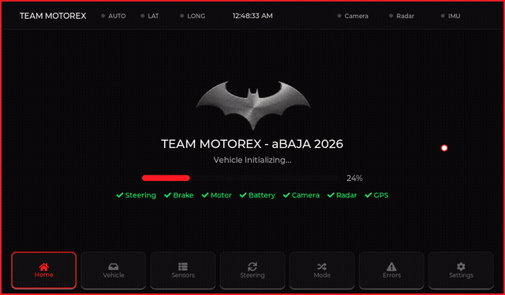

# 🚗 Autonomous Vehicle Telemetry & Steer-By-Wire (SBW) Dashboard

[](#building-and-running)
[](https://en.wikipedia.org/wiki/C11_(C_standard_revision))
[](https://en.wikipedia.org/wiki/C%2B%2B17)
[](https://lvgl.io/)
[](https://www.libsdl.org/)
[](https://www.kernel.org/doc/Documentation/networking/can.txt)
[](licence.txt)

Core vehicle initialization, telemetry operating system, and graphical instrument cluster engineered for **Team Motorex (SAE Baja 2026)**. Built with **LVGL 9.x** and **SDL2**, featuring direct **Linux SocketCAN** integration, Steer-By-Wire (SBW) closed-loop control, autonomous driving mode orchestration for NVIDIA Jetson platforms, and multi-sensor diagnostics tailored for **1024×600** automotive touchscreens.

---

## 📹 Live Demo



> 🎥 **Full Video Demonstration**: A high-definition recording is available at [docs/media/Motorex_dashbaord_video.mp4](docs/media/Motorex_dashbaord_video.mp4).

---

## ✨ Key Capabilities & System Features

### 1. 🏎️ Primary Drive Telematics (`Home Screen`)
* **Dynamic Speedometer & RPM**: Real-time vehicle speed and motor RPM calculated via wheel circumference ($1.95\text{ m}$) and gear ratio ($5.7:1$).
* **State of Charge (SOC) & Battery Telemetry**: Visual battery capacity gauge with voltage and power draw readouts.
* **Accelerator & Regenerative Braking Bars**: Dual responsive percentage meters reflecting driver inputs and regenerative retardation.
* **Top Status Pill Matrix**: Real-time active indicators for autonomous status (`AUTO`, `LAT`, `LONG`) and sensor connectivity (`Camera`, `Radar`, `IMU`).

### 2. 🛞 Steer-By-Wire (SBW) Control Subsystem (`Steering Screen`)
* **Real-time Closed-Loop Feedback**: Live visual steering wheel orientation powered by high-resolution **AS5600 magnetic rotary encoder** feedback.
* **Target Steering Command Input**: On-screen interactive target steering angle slider and full numeric keypad with angle validation ($-60^\circ$ to $+60^\circ$).
* **Encoder Offset Calibration**: Dynamic runtime calibration offset adjustment matching Teensy 4.x MCU protocol firmware.

### 3. 🤖 Autonomous Driving Modes (`Mode Screen`)
* **Active CAN Broadcast to NVIDIA Jetson**: Real-time broadcast on CAN ID `0x400` coordinating high-level vehicle intelligence.
* **Operational Modes**:
  * 🛑 **Standby**: Manual driver intervention and staging mode.
  * 🚨 **AEB (Autonomous Emergency Braking)**: Active radar/lidar safety override.
  * 🛣️ **LKA (Lane Keep Assist)**: Vision-guided path tracking.
  * 🏁 **Endurance**: Optimized energy consumption and thermal management mode for SAE Baja endurance events.

### 4. 🛰️ Perception & Hardware Sensor Health (`Sensors Screen`)
* **Subsystem Monitoring**: Dedicated diagnostic status monitors for **Radar**, **Monocular/Stereo Cameras**, **LiDAR**, **IMU (6-DOF)**, and **Wheel Speed Sensors**.
* **Live Fault Detection**: Instant visual alerts on sensor disconnection, timeout, or invalid checksums.

### 5. 🔌 Dual Motor Controller Telemetry (EZkontrol Protocol V1.1)
* Decodes high-speed CAN frames from the primary traction motor controller:
  * `0x180117EF` (**MSG1**): Bus Voltage, DC Bus Current, Phase Current, Motor RPM.
  * `0x180217EF` (**MSG2**): Controller Temperature, Motor Temperature, Throttle %, Mechanical Brake State, Contactor State, Fault Flags.

---

## 📡 CAN Bus Architecture & Protocol Reference

The instrument cluster communicates across vehicle networks via **SocketCAN**:

| Subsystem | CAN ID | Direction | DLC | Description |
|:---|:---:|:---:|:---:|:---|
| **Steering Command** | `0x103` | Linux $\rightarrow$ Teensy | 2 | Target steering angle command (uint16 encoded, LE) |
| **Steering Status** | `0x063` | Teensy $\rightarrow$ Linux | 1 | AS5600 encoder status (`0` = Nominal, `1` = Error) |
| **Steering Feedback** | `0x203` | Teensy $\rightarrow$ Linux | 2 | Live steering angle feedback |
| **Autonomous Mode** | `0x400` | Linux $\rightarrow$ Jetson Nano | 2 | Active driving mode selection command |
| **Motor Controller 1** | `0x180117EF` | MCU $\rightarrow$ Meter | 8 | DC Bus Voltage, Bus Current, Phase Current, RPM |
| **Motor Controller 2** | `0x180217EF` | MCU $\rightarrow$ Meter | 8 | Controller/Motor Temp, Throttle %, Brake %, Faults |

---

## 🗂️ Project Structure

```text
├── CMakeLists.txt                 # CMake build configuration
├── README.md                      # Project documentation & guides
├── licence.txt                    # MIT open-source license
├── lv_conf.h                      # LVGL configuration (color depth, memory, drivers)
├── lv_conf.defaults               # LVGL default configuration
├── manifest.json                  # Project metadata
├── simulator.code-workspace       # VS Code workspace with launch & debug tasks
│
├── src/                           # Application source code
│   ├── main.c                     # Primary telemetry OS & 7-screen UI coordinator
│   ├── hal/                       # Hardware Abstraction Layer (SDL2 / Linux display)
│   ├── motorex_bat.c              # Battery UI graphic asset
│   ├── steering_wheel.c           # Dynamic steering wheel graphic asset
│   ├── car_chassis.c              # Vehicle chassis graphic asset
│   ├── throttle_pedal.c           # Throttle pedal graphic asset
│   ├── brake_rotor.c              # Brake rotor graphic asset
│   └── freertos/                  # Optional FreeRTOS POSIX port files
│
├── docs/                          # Documentation & media assets
│   └── media/                     # Demo video and animated GIF
│       ├── dashboard_demo.gif
│       └── Motorex_dashbaord_video.mp4
│
├── lvgl/                          # LVGL 9.x submodule
└── FreeRTOS/                      # FreeRTOS kernel submodule
```

---

## 🛠️ Getting Started & Dependencies

### Linux / Ubuntu / WSL2

Install required build dependencies and development libraries:

```bash
sudo apt update
sudo apt install -y \
    build-essential \
    cmake \
    libsdl2-dev \
    git \
    can-utils
```

Verify your toolchain:
```bash
sdl2-config --version
cmake --version
gcc --version
```

---

## 🚀 Building and Running

### 1. Clone Repository (with Submodules)

Ensure submodules are cloned recursively to pull the LVGL and FreeRTOS libraries:

```bash
git clone --recursive https://github.com/Abhi-jith4/autonomous-vehicle-dashboard.git
cd autonomous-vehicle-dashboard
```

*(If cloned previously without `--recursive`, initialize submodules with:)*
```bash
git submodule update --init --recursive
```

### 2. Configure & Compile

```bash
# Generate build files
mkdir -p build && cd build
cmake ..

# Compile using all CPU cores
make -j$(nproc)
```

### 3. Run the Dashboard

```bash
# Launch instrument cluster executable
../bin/main
```

---

## 💻 Visual Studio Code Integration

This project includes preconfigured build and debug profiles:

1. Open `simulator.code-workspace` in VS Code (`File` $\rightarrow$ `Open Workspace from File...`).
2. Press <kbd>Ctrl</kbd> + <kbd>Shift</kbd> + <kbd>B</kbd> to execute the automated **Build and Run** task.
3. For interactive debugging, navigate to the **Run & Debug** panel and launch `Debug LVGL demo with gdb` (or press <kbd>F5</kbd>).

---

## 📄 License

This project is licensed under the [MIT License](licence.txt).
